# Profilescape cards

Generated by [Profilescape](https://github.com/chethandvg/profilescape) for [@fakhriaditiarahman](https://github.com/fakhriaditiarahman).
This branch is rewritten by every run as a single commit with no history, so please do not edit it by hand.

## Preview

<picture>
  <source media="(prefers-color-scheme: dark)" srcset="./3d-dark.svg" />
  
</picture>

## Use in a README

Paste this where the cards should appear. Keep the markers if you want the `readme` input to keep it up to date.

```html
<!-- profilescape:start -->

<picture>
  <source media="(prefers-color-scheme: dark)" srcset="https://raw.githubusercontent.com/fakhriaditiarahman/PortoVue/profilescape-output/3d-dark.svg" />
  
</picture>

<!-- profilescape:end -->
```
